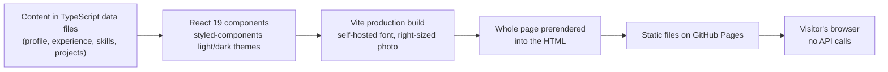
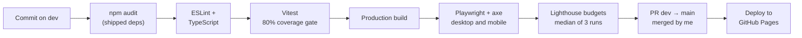
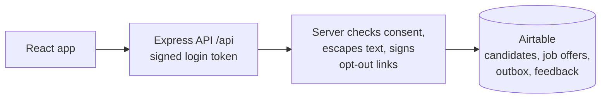
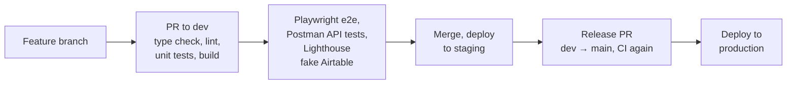

# Szymon Rojek: Software Test Engineer

**Live site: [szymonrojek.com](https://szymonrojek.com/)** · [LinkedIn](https://www.linkedin.com/in/szymon--rojek/)

[](https://github.com/SzymonRojek/homepage/actions/workflows/ci.yml)

<picture>
  <source media="(prefers-color-scheme: dark)" srcset="docs/screenshot-dark.png" />
  
</picture>

## Why this site exists (30-second summary)

- **Who:** Software Test Engineer with four years' experience testing financial and shareholder data migrations at Equiniti. Data migration and ETL testing, SQL reconciliation, REST API testing, growing into test automation with Playwright and TypeScript.
- **Looking for:** QA, Test Automation, AI Testing and Front-End roles. Based in Hove, UK, with full right to work in the UK, and open to relocation.
- **What the site proves:** a CV can say "Playwright" and "CI/CD", but this repository shows it. The site is a small production system that ships only when unit, end-to-end, accessibility, performance and security checks all pass, and every decision behind it is written up below.

| At a glance           |                                                                                      |
| --------------------- | ------------------------------------------------------------------------------------ |
| Automated tests       | 175 unit and component tests, 121 end-to-end runs (desktop and mobile)               |
| Coverage              | about 97%, with an 80% gate that fails CI                                            |
| Lighthouse (enforced) | accessibility, best practices and SEO 100, performance budget enforced on every push |
| Accessibility         | 0 serious or critical axe violations, in the light and the dark theme                |
| Runtime API calls     | 0, so nothing can fail for a visitor                                                 |
| Deploys               | only from `main`, only after every check passes, only through a PR I merge           |

## Links for job applications

The case studies start closed. A link can open one at a chosen side, so each CV points to the part that matters for that role:

| Applying for        | Link                                                          |
| ------------------- | ------------------------------------------------------------- |
| Test automation, QA | https://szymonrojek.com/#case-study-talent-outreach-tester    |
| Developer           | https://szymonrojek.com/#case-study-talent-outreach-developer |
| The whole page      | https://szymonrojek.com/                                      |

## Case study: this website, built and tested like a real product

### Problem

The earlier version loaded my projects from the GitHub API in the visitor's browser. That API allows 60 unauthenticated requests per hour per IP address, so a recruiter on a shared office network could see an error box in the middle of a tester's portfolio.

### Constraints

- Free static hosting on GitHub Pages at my own domain, with no server.
- One maintainer with limited time, so automation has to catch regressions.
- WCAG AA colour contrast in both the light and the dark theme.

### Architecture

What a visitor's browser loads. All content is static, so there is nothing to time out or rate-limit:



How every change reaches production:



### Key decisions and trade-offs

| Decision                                                                                                                  | Why                                                                                                                        | Trade-off                                                                                                                                                                                    |
| ------------------------------------------------------------------------------------------------------------------------- | -------------------------------------------------------------------------------------------------------------------------- | -------------------------------------------------------------------------------------------------------------------------------------------------------------------------------------------- |
| A colour-block design: a near-black hero and footer, one deep green band, a mint "green." and a yellow accent for actions | A calm, memorable first impression for HR, instead of gradients and glows; the page opens and closes on the same dark      | Every text colour pair is checked for WCAG AA by hand in `theme.ts`, and axe checks them again in CI                                                                                         |
| One shared content column for the bar, hero and sections                                                                  | The edges line up at every screen width, and wider screens get wider margins                                               | Full-width bands need an inner wrapper. An e2e test measures the edges at four widths                                                                                                        |
| A floating top bar that hides while you read                                                                              | It barely shows over the hero, lifts off once the page scrolls, and slides away while you read down, back on any scroll up | Its three states depend on scroll position, so the rule is a pure function with its own unit tests, and an e2e test scrolls through them                                                     |
| Every section on its own background, the seams measured                                                                   | White next to cream (1.09:1) ran the sections together, so each pair of neighbours now differs by about 1.15:1 or more     | Sand and white take turns between the dark and the green, so moving a section means re-checking its neighbours. Every text pair is re-checked for AA, and axe checks it again in both themes |
| Static project data instead of the GitHub API                                                                             | Rate limits on shared networks could show recruiters an error                                                              | Descriptions are updated by hand. An e2e fixture fails if the page ever calls the GitHub API again                                                                                           |
| Test pyramid: Vitest, then Playwright, then axe                                                                           | Fast feedback on logic, real confidence in what visitors see                                                               | E2E takes about a minute, so it covers only user-visible behaviour                                                                                                                           |
| 80% coverage gate that leaves out styles                                                                                  | Coverage should measure logic, not CSS                                                                                     | Styles are checked by the e2e and axe tests instead                                                                                                                                          |
| Paint the theme before JavaScript loads                                                                                   | Reloading in dark mode briefly flashed a light page                                                                        | The background colours live in two places. A unit test keeps them in sync                                                                                                                    |
| Prerender the page into the HTML at build time                                                                            | Search engines and AI tools that don't run JavaScript saw an empty page                                                    | Components must render without a browser. A unit test renders the page in Node and fails if one reaches for it                                                                               |
| Self-hosted fonts and a right-sized photo                                                                                 | Google Fonts blocked rendering, and the photo was three times larger than displayed                                        | Font updates are manual: three variable woff2 fonts live in `public/fonts`, and the two of the first screen are preloaded in the HTML                                                        |
| Lighthouse judged on the median of three runs                                                                             | The default (best run) could let a budget pass by luck                                                                     | Slower CI, and a stricter budget                                                                                                                                                             |
| Protected `main`, dev-first workflow, PRs I merge myself                                                                  | Every push to `main` deploys. The rule also stops an AI coding assistant shipping on its own                               | Even a one-line fix needs a PR and a green pipeline                                                                                                                                          |

### Testing, performance, accessibility and security

**Testing.** Vitest and Testing Library cover logic and components: theme state and persistence, the OS theme listener, the first-paint theme colours, the top bar menu, project cards, case studies and the links that open them, and the scroll position after a reload. Playwright runs against the production build in desktop and mobile Chrome, and also checks that the top bar, the hero and the sections line up at several screen widths, that the headline and photo only shrink as the window narrows, that the top bar hides past the hero and returns on scroll up, and that the CI gates and the numbers on the project cards animate only once in view. Tests are grouped by page section, use named steps for longer scenarios, and are tagged `@desktop` or `@mobile` when they apply to one viewport only. Role-based locators also check that every control has an accessible name. Other end-to-end tests read the page with JavaScript turned off and check what search engines and link previews get: the structured data, the share image, the sitemap and both case studies in the HTML. Unit tests also check that every quoted recommendation, and the phrase marked in it, is word for word from the original. Every test fails if the page calls the GitHub API. Stryker mutation testing (`npm run test:mutation`, or the manual GitHub workflow) checks that the unit tests actually catch bugs. Style-only files are left out, as they are from coverage. After targeted tests, every mutant in the files that had gaps was caught (102 killed, 8 timed out).

**Performance.** Lighthouse runs three times on every push. CI fails if the median performance score drops below 0.85 or layout shift goes above 0.1, and warns when the largest paint is slower than 2.5 s. Self-hosting the font and resizing the photo raised the mobile performance score from 0.84 to about 0.9 on my machine and brought the first paint forward from 3.0 s to about 2.2 s. The photo went from 117 KB to 54 KB, and the JavaScript is about 117 KB gzipped. The build also writes the whole page into the HTML (`scripts/prerender.ts`), so it can be read without JavaScript, and in the light theme React takes it over as it is, so the photo isn't drawn twice.

**Accessibility.** axe scans the page in the light and the dark theme with every case study expanded, and any serious or critical violation fails the build. Lighthouse accessibility must stay at 95 or above (it is 100 today). The page uses semantic headings and landmarks (each section a numbered h2), labelled lists, a theme button with `aria-pressed`, a phone menu that is hidden from the keyboard and screen readers while closed, and decorative icons hidden from screen readers. The portrait's slider works with the arrow keys, a mouse click or a single tap, so it never needs a drag (WCAG 2.5.7). Buttons that repeat on both project cards say which project they are for ("Case study: Talent Outreach"), and every animation stops with reduced motion.

**Security.** There are no secrets and no runtime API calls. `npm audit` fails CI on high-severity advisories in the dependencies shipped to visitors, and Dependabot proposes npm and GitHub Actions updates every week, targeted at `dev`. External links use `rel="noreferrer"`. Development-only tools such as Lighthouse CI still carry some advisories. They never reach the browser, which is why the audit gate covers only shipped dependencies.

### Outcomes

- Projects render instantly and can't fail for a visitor: the section no longer depends on GitHub's API.
- Search engines and AI tools that don't run JavaScript read the whole page, case studies included.
- No light flash on reload in dark mode, proven by a test that records the background colour on every frame.
- Lighthouse accessibility, best practices and SEO all score 100; performance is held by a CI budget.
- Every deploy has passed the full pipeline, because `main` accepts nothing else.

## Case study: Talent Outreach, job offers to the right candidates

**[Code](https://github.com/SzymonRojek/talent-outreach)** · **[Live demo](https://talent-outreach.onrender.com/?utm_source=github)** (one click on "Try the demo", no password; the free server can take up to a minute to wake up, and the demo data resets every night)

A full-stack React, Express and TypeScript recruitment tool, with data in Airtable. It started in 2021 as an email CRUD app ("Email Campaign Dashboard"); I reviewed it like a tester, rebuilt it to production standard and then narrowed it to one recruiter's problem: the right job offer to the right candidates, and not to anyone contacted in the last 14 days.

| At a glance        |                                                                                                             |
| ------------------ | ----------------------------------------------------------------------------------------------------------- |
| Secrets in browser | 0: only the Express server talks to Airtable                                                                |
| Automated tests    | 200+ server and client unit tests, 63 Playwright end-to-end tests, a Postman collection (Newman)            |
| Accessibility      | Lighthouse on 7 screens in CI: accessibility, best practices and SEO must stay at 100                       |
| Test data          | end-to-end, API and Lighthouse runs use a fake Airtable, so they never touch real data                      |
| Bugs fixed         | 11 found and fixed in the first review                                                                      |
| Delivery           | pull request checks, then staging, then production, all automatic                                           |
| Live demo          | one-click login, outbox instead of real sending, nightly reset and live check, Sentry without personal data |

### The brief

A small recruitment agency keeps its candidates in a spreadsheet. Every new job offer means filtering by hand, pasting addresses into Gmail and writing "Dear candidate", with the risk of leaking addresses or contacting the same people too often.

| Spreadsheet and Gmail                                   | Talent Outreach                                                                                     |
| ------------------------------------------------------- | --------------------------------------------------------------------------------------------------- |
| Filter the sheet by hand and copy the addresses         | Pick a role and a budget, and the matching candidates are found                                     |
| "Dear candidate" for everyone                           | Every email uses the candidate's name and the role; a mistyped placeholder is caught before sending |
| Nobody remembers who got which offer                    | Candidates contacted in the last 14 days are skipped by default                                     |
| Consent is a column nobody updates                      | Only candidates open to offers get emails; the opt-out link updates the status by itself            |
| One address in CC instead of BCC leaks everyone's email | One email per candidate, so nobody sees the others                                                  |
| What was sent is buried in the Sent folder              | An outbox for each job offer shows every email exactly as it was sent                               |

Not built yet: real delivery. Every email is built, checked and saved to the outbox; sending it through an email service is one more transport in one file.

### Problem

The 2021 app sent emails through EmailJS straight from the browser. The Airtable key sat behind an Express proxy, but the login ran only in the browser, so anyone who called the API directly could read, change or delete every record. The API had been tested by hand in Postman, there were no automated tests or CI, and the free Heroku hosting had ended.

### Architecture





### Key decisions and trade-offs

| Decision                                                          | Why                                                                          | Trade-off                                                                                                                   |
| ----------------------------------------------------------------- | ---------------------------------------------------------------------------- | --------------------------------------------------------------------------------------------------------------------------- |
| Server-side login, signed tokens, lockout after 5 wrong passwords | A browser-only login didn't protect the API at all                           | The lockout lives in memory and resets when the free server restarts; it counts the real address behind Cloudflare          |
| A one-click demo login, only where the demo is switched on        | A reviewer should try the app without a password                             | Any server without the setting has no passwordless door; API clients still use the password                                 |
| The browser suggests recipients, the server has the last word     | Filtering by role, budget and last contact needs a fast, interactive list    | The server re-checks consent on every send, so an outdated list can't reach someone who opted out                           |
| An outbox instead of real sending in the demo                     | Anyone can enter the public demo, and the free host blocks SMTP              | Nobody gets the emails; each one is saved and can be opened. Real delivery is one more transport in one file, not built yet |
| End-to-end, API and Lighthouse runs against a fake Airtable       | Tests must never touch real data, and CI shouldn't need secrets              | The fake can drift from the real API, so it copies Airtable's records and errors                                            |
| Nightly reset, then a read-only check of the live app             | Visitors change the data, and the next reviewer should see a working example | New examples are created before old ones are deleted; the reset is skipped when nothing changed                             |
| One recruiter problem instead of a generic newsletter tool        | A problem solved end to end is easier to explain, to use and to test         | Fewer features: the app only sends job offers to candidates                                                                 |
| Error monitoring without personal data                            | I need to see failures on the live demo without collecting data I don't need | Sentry gets no IPs, headers or request bodies, so some errors are harder to reproduce                                       |
| Staging before production, with a hotfix path                     | Changes are checked on a live copy before users see them                     | Two environments to keep in sync; a hotfix must be merged back into `dev`                                                   |

### What the first review found

- The Airtable token leaked in error responses.
- Unchecking every recipient sent the email to **all** of them: an empty selection was treated as "no filter".
- Lists silently stopped at 100 records, because Airtable pages its results.
- Polish names such as Łukasz sorted after "z" until sorting used a Polish locale.
- Deleting a record didn't wait for Airtable, so a failure could crash the server.

## For developers

### Tech stack

| Area      | Tools                                                                                               |
| --------- | --------------------------------------------------------------------------------------------------- |
| Front-end | React 19, TypeScript (strict), Vite                                                                 |
| State     | Redux Toolkit (theme)                                                                               |
| Styling   | styled-components with light and dark themes, self-hosted Bricolage Grotesque, Geist and Geist Mono |
| Testing   | Vitest, Testing Library, Playwright, axe-core, Lighthouse CI, Stryker                               |
| Quality   | ESLint, Prettier, GitHub Actions, npm audit, Dependabot                                             |
| Hosting   | GitHub Pages, deployed automatically from `main`                                                    |

### Getting started

Requires Node 22.18+ (the build runs a TypeScript script directly); CI uses Node 24.

```bash
npm install
npm run dev          # http://localhost:3000/
```

| Script                    | What it does                                                     |
| ------------------------- | ---------------------------------------------------------------- |
| `npm run dev`             | Start the dev server                                             |
| `npm run build`           | Build the site into `dist/` and prerender the page into its HTML |
| `npm run preview`         | Serve the production build locally                               |
| `npm test`                | Unit and component tests in watch mode                           |
| `npm run test:coverage`   | Single test run with a coverage report and thresholds            |
| `npm run test:e2e`        | Playwright end-to-end tests (builds and serves the site)         |
| `npm run test:mutation`   | Stryker mutation testing of the unit tests (slow, run manually)  |
| `npm run test:lighthouse` | Lighthouse budgets against `dist/` (run `build` first)           |
| `npm run typecheck`       | TypeScript check                                                 |
| `npm run lint`            | ESLint                                                           |

### CI and deployment

Work happens on the `dev` branch. Every push to `dev` or `main` and every pull request runs, in [GitHub Actions](.github/workflows/ci.yml): the dependency audit, lint, type check, unit tests with the coverage gate, the build, the end-to-end and accessibility tests and the Lighthouse budgets. Mutation testing runs separately, by hand: the [Mutation testing workflow](.github/workflows/mutation.yml) ("Run workflow" in the Actions tab) runs Stryker on GitHub's servers, writes the score per file to the run summary and uploads the HTML report. `main` is production and is protected: changes reach it only through a pull request from `dev` with passing checks, and only `main` deploys to GitHub Pages.

### Editing content

All text lives in data files, not in components:

| File                                              | Content                                                                                                                                                                                                 |
| ------------------------------------------------- | ------------------------------------------------------------------------------------------------------------------------------------------------------------------------------------------------------- |
| `src/features/Homepage/profile.ts`                | Name, job title, the line over the headline, headline, target roles, location (search data only), bio, the footer's heading and note, LinkedIn                                                          |
| `src/features/Homepage/recommendationsData.ts`    | LinkedIn recommendations, quoted word for word, the phrase marked in each, and the headline quote                                                                                                       |
| `src/features/Homepage/howITestData.ts`           | The "How I test at work" section: my story and the three steps                                                                                                                                          |
| `src/features/Homepage/skillsData.ts`             | Testing, automation and programming skills, tools and languages for "Skills & learning"                                                                                                                 |
| `src/features/Homepage/experienceData.ts`         | Experience, and courses for the "Learning" list in "Skills & learning"                                                                                                                                  |
| `src/features/Homepage/Portfolio/projectsData.ts` | Projects (the featured one, tags and the numbers or CI gates on the cards, the section's two-line title), `caseStudy` write-ups, their brief/research/solution/value stories and developer/tester views |
| `src/features/Homepage/Portfolio/pipelineData.ts` | The CI checks shown in the homepage case study's tester view, and the gates on this site's card                                                                                                         |

Search engines get the same facts as structured data, built from these files (`structuredData.ts`). The share card for link previews, `public/og-image.jpg`, shows the name, title and headline as an image, so redraw it when they change.

To add a case study, fill in the `caseStudy` field of a project in `projectsData.ts`. The project then shows as a card whose "Case study" button opens the full write-up. Keep this README's case study in step with the homepage one.
