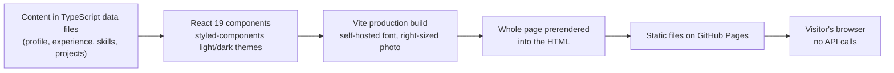
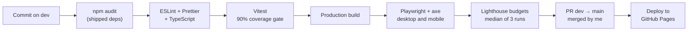

# Szymon Rojek: Test Engineer

**Live site: [szymonrojek.com](https://szymonrojek.com/)** · [LinkedIn](https://www.linkedin.com/in/szymon--rojek/)

[](https://github.com/SzymonRojek/homepage/actions/workflows/ci.yml)

## Why this site exists (30-second summary)

- **Who:** Test Engineer with four years' experience testing financial and shareholder data migrations at Equiniti. Data migration and ETL testing, SQL reconciliation, REST API testing, growing into test automation with Playwright and TypeScript.
- **Open to:** QA, Test Automation and Front-End roles, and to relocation. Based in Hove, UK, with full right to work in the UK.
- **What the site proves:** a CV can say "Playwright" and "CI/CD", but this repository shows it. The site is a small production system that ships only when unit, end-to-end, accessibility, performance and security checks all pass, and every decision behind it is written up below.

| At a glance           |                                                                                                                                                            |
| --------------------- | ---------------------------------------------------------------------------------------------------------------------------------------------------------- |
| Automated tests       | 220 unit and component tests, 184 end-to-end runs in Chrome (desktop and mobile) on every push, and 430 in Safari (desktop, iPad, iPhone) every two months |
| Coverage              | about 98%, with a 90% gate on the whole project and a floor every file must clear                                                                          |
| Lighthouse (enforced) | accessibility, best practices and SEO 100, performance budget enforced on every push                                                                       |
| Accessibility         | 0 serious or critical axe violations, in the light and the dark theme                                                                                      |
| Runtime API calls     | 0, so nothing can fail for a visitor                                                                                                                       |
| Deploys               | only from `main`, only after every check passes, only through a PR I merge                                                                                 |

## Links for job applications

Each CV points at the part of the page that matters for the role it answers. The case studies start closed, and a link opens one at a chosen side: see [Other work](#other-work) for the Talent Outreach links, or send [szymonrojek.com](https://szymonrojek.com/) for the whole page.

## How it's tested

**Testing.** Vitest and Testing Library cover logic and components: theme state and persistence, the OS theme listener, the first-paint theme colours, the top bar menu, project cards, case studies and the links that open them, and the scroll position after a reload. Playwright runs against the production build in desktop and mobile Chrome, and, every two months or by hand, again in Safari's engine (WebKit) on a desktop, an iPad held both ways and two iPhones, and also checks that the hero photo is actually drawn on screen (its pixels, not only its box), that the top bar, the hero and the sections line up at several screen widths, that the headline and photo only shrink as the window narrows and the photo stays about as tall as the text beside it, that the top bar goes with scrolling down and returns after a short scroll back up, that a reload goes back to the same place without flashing the top bar (also when the browser skips `pagehide`, as an iPhone can), that every section changes its background with the theme, that the rings and the bug stay next to the content on wide screens, and that the CI gates and the numbers on the project cards animate only once in view. Tests are grouped by page section, use named steps for longer scenarios, and are tagged `@desktop` or `@mobile` when they apply to one viewport only. Role-based locators also check that every control has an accessible name. Other end-to-end tests read the page with JavaScript turned off and check what search engines and link previews get: the structured data, the share image, the sitemap and both case studies in the HTML. Three more start the page in a browser that isn't friendly, since that is what a visitor's machine can be: with storage blocked, as in a private window, with an address that can't be decoded, and with the script blocked altogether, where the page has to stay readable rather than go blank. Unit tests also check that every quoted recommendation, and the phrase marked in it, is word for word from the original. Every test fails if the page calls the GitHub API. Stryker mutation testing (`npm run test:mutation`, or the manual GitHub workflow) checks that the unit tests actually catch bugs, and [`docs/e2e-workflow.md`](docs/e2e-workflow.md) covers how the end-to-end suite is run and audited for the same thing. Style-only files are left out, as they are from coverage. After targeted tests, every mutant in the files that had gaps was caught (102 killed, 8 timed out).

**Performance.** Lighthouse runs three times on every push. CI fails if the median performance score drops below 0.85 or layout shift goes above 0.1, and warns when the largest paint is slower than 2.5 s. Self-hosting the font and resizing the photo took the mobile performance score from 0.84 to 0.96, with layout shift at 0.001 (PageSpeed, 2026-10-18). The photo went from 117 KB to 50 KB, and the JavaScript is about 129 KB gzipped. The build also writes the whole page into the HTML (`scripts/prerender.ts`), so it can be read without JavaScript, and in the light theme React takes it over as it is, so the photo isn't drawn twice.

**Accessibility.** axe scans the page in the light and the dark theme with every case study expanded, and any serious or critical violation fails the build, including Label in Name (WCAG 2.5.3), the rule that a control's accessible name must contain the words printed on it; axe leaves it off by default, and Lighthouse asserts it too. Lighthouse accessibility must stay at 95 or above (it is 100 today). The page uses semantic headings and landmarks (each section a numbered h2), labelled lists, a theme button with `aria-pressed`, a phone menu that is hidden from the keyboard and screen readers while closed, and decorative icons hidden from screen readers. Buttons that repeat on both project cards say which project they are for ("Case study: Talent Outreach"), and every animation stops with reduced motion. In forced-colours mode, such as Windows high contrast, the menu button's lines take a system colour, since the palette there overrides an author's and would otherwise leave the button looking empty.

**Security.** There are no secrets and no runtime API calls. The built page carries its own content security policy, written in by the prerender with a hash for every inline script, because GitHub Pages serves the page as it is and cannot send headers; scripts are allowed by hash alone, with no `unsafe-inline` and no `unsafe-eval`, and an end-to-end test fails on any refusal the browser reports. A meta tag can't carry HSTS or `frame-ancestors`, and `nosniff` has no meta either, so those three wait for a proxy in front of the site; `Referrer-Policy` travels as a meta. `npm audit` fails CI on high-severity advisories in the dependencies shipped to visitors, and Dependabot proposes npm and GitHub Actions updates every month, targeted at `dev`. External links use `rel="noreferrer"`. Nothing the browser is asked for is taken on trust: the reads of storage and of the address happen behind a guard, because they run before React draws anything, and an error boundary keeps my email address and links on screen if a render throws. Development-only tools such as Lighthouse CI still carry some advisories. They never reach the browser, which is why the audit gate covers only shipped dependencies.

## Tech stack

| Area      | Tools                                                                                               |
| --------- | --------------------------------------------------------------------------------------------------- |
| Front-end | React 19, TypeScript (strict), Vite                                                                 |
| State     | Redux Toolkit (theme)                                                                               |
| Styling   | styled-components with light and dark themes, self-hosted Bricolage Grotesque, Geist and Geist Mono |
| Testing   | Vitest, Testing Library, Playwright, axe-core, Lighthouse CI, Stryker                               |
| Quality   | ESLint, Prettier, GitHub Actions, npm audit, Dependabot                                             |
| Hosting   | GitHub Pages, deployed automatically from `main`                                                    |

## Case study: this website, built and tested like a real product

### Problem

The earlier version loaded my projects from the GitHub API in the visitor's browser. That API allows 60 unauthenticated requests per hour per IP address, so a recruiter on a shared office network could see an error box in the middle of a tester's portfolio.

### Constraints

- Free static hosting on GitHub Pages at my own domain, with no server.
- One maintainer with limited time, so automation has to catch regressions.
- WCAG AA colour contrast in both the light and the dark theme.

### Architecture

What a visitor's browser loads. All content is static, so there is nothing to time out or rate-limit:



How every change reaches production:



### Key decisions and trade-offs

| Decision                                                                                                                                                                                                                                                            | Why                                                                                                                                                                                                                                                                                                     | Trade-off                                                                                                                                                                                                                                                          |
| ------------------------------------------------------------------------------------------------------------------------------------------------------------------------------------------------------------------------------------------------------------------- | ------------------------------------------------------------------------------------------------------------------------------------------------------------------------------------------------------------------------------------------------------------------------------------------------------- | ------------------------------------------------------------------------------------------------------------------------------------------------------------------------------------------------------------------------------------------------------------------ |
| A colour-block design: a near-black hero and footer, deep green for the top bar and the featured project, a sand band for the How I use AI section that opens the page and (in the dark theme) the How I test band, a mint "green." and a yellow accent for actions | A calm, memorable first impression for HR, instead of gradients and glows; the page opens and closes on the same dark                                                                                                                                                                                   | Every text colour pair is checked for WCAG AA by hand in `theme.ts`, and axe checks them again in CI                                                                                                                                                               |
| One shared content column for the bar, hero and sections                                                                                                                                                                                                            | The edges line up at every screen width, and wider screens get wider margins                                                                                                                                                                                                                            | Full-width bands need an inner wrapper. An e2e test measures the edges at four widths                                                                                                                                                                              |
| A floating top bar that hides while you read                                                                                                                                                                                                                        | Only an outline at the top, it slides away from the first scroll down and comes back raised once you scroll back up a little (16px), and gives up its green within 120px of the top so the fade is over before the page stops, so it never covers what you read; a reload part way down keeps it hidden | Its three states depend on scroll position, so the rule is a pure function with its own unit tests, and an e2e test scrolls through them                                                                                                                           |
| Every section on its own background, the seams measured                                                                                                                                                                                                             | White next to cream (1.09:1) ran the sections together, so each pair of neighbours now differs by about 1.15:1 or more                                                                                                                                                                                  | Every section between the dark hero and footer changes with the theme (an e2e test checks each), and sand and white take turns, so moving a section means re-checking its neighbours. Every text pair is re-checked for AA, and axe checks it again in both themes |
| Static project data instead of the GitHub API                                                                                                                                                                                                                       | Rate limits on shared networks could show recruiters an error                                                                                                                                                                                                                                           | Descriptions are updated by hand. An e2e fixture fails if the page ever calls the GitHub API again                                                                                                                                                                 |
| Test pyramid: Vitest, then Playwright, then axe                                                                                                                                                                                                                     | Fast feedback on logic, real confidence in what visitors see                                                                                                                                                                                                                                            | E2E takes about a minute, so it covers only user-visible behaviour                                                                                                                                                                                                 |
| 90% coverage gate that leaves out styles                                                                                                                                                                                                                            | Coverage should measure logic, not CSS                                                                                                                                                                                                                                                                  | Styles are checked by the e2e and axe tests instead                                                                                                                                                                                                                |
| Paint the theme before JavaScript loads                                                                                                                                                                                                                             | Reloading in dark mode briefly flashed a light page                                                                                                                                                                                                                                                     | The background colours live in two places. A unit test keeps them in sync                                                                                                                                                                                          |
| Prerender the page into the HTML at build time                                                                                                                                                                                                                      | Search engines and AI tools that don't run JavaScript saw an empty page                                                                                                                                                                                                                                 | Components must render without a browser. A unit test renders the page in Node and fails if one reaches for it                                                                                                                                                     |
| Self-hosted fonts and a right-sized photo                                                                                                                                                                                                                           | Google Fonts blocked rendering, and the photo was three times larger than displayed                                                                                                                                                                                                                     | Font updates are manual: three variable woff2 fonts live in `public/fonts`, and the two of the first screen are preloaded in the HTML                                                                                                                              |
| Lighthouse judged on the median of three runs                                                                                                                                                                                                                       | The default (best run) could let a budget pass by luck                                                                                                                                                                                                                                                  | Slower CI, and a stricter budget                                                                                                                                                                                                                                   |
| Protected `main`, dev-first workflow, PRs I merge myself                                                                                                                                                                                                            | Every push to `main` deploys. The rule also stops an AI coding assistant shipping on its own                                                                                                                                                                                                            | Even a one-line fix needs a PR and a green pipeline                                                                                                                                                                                                                |

### Outcomes

- Projects render instantly and can't fail for a visitor: the section no longer depends on GitHub's API.
- Search engines and AI tools that don't run JavaScript read the whole page, case studies included.
- No light flash on reload in dark mode, proven by a test that records the background colour on every frame.
- Lighthouse accessibility, best practices and SEO all score 100; performance is held by a CI budget.
- Every deploy has passed the full pipeline, because `main` accepts nothing else.

## Other work

**[Talent Outreach](https://github.com/SzymonRojek/talent-outreach)** — a full-stack app that sends job offers to the right candidates: React and TypeScript on the front, an Express API behind it, Airtable as the store. 200+ unit tests, 63 Playwright flows and 56 API checks, with the end-to-end, API and Lighthouse runs against a fake Airtable so they never touch real data. The write-up lives in that repository, and the case study on the site opens at the side a role cares about:

| Applying for        | Link                                                          |
| ------------------- | ------------------------------------------------------------- |
| Test automation, QA | https://szymonrojek.com/#case-study-talent-outreach-tester    |
| Developer           | https://szymonrojek.com/#case-study-talent-outreach-developer |

**What the first review of it found**, before any of the tests above existed:

- The Airtable token leaked in error responses.
- Unchecking every recipient sent the email to **all** of them: an empty selection was treated as "no filter".
- Lists silently stopped at 100 records, because Airtable pages its results.
- Polish names with accented letters sorted after "z" until sorting used a Polish locale.
- Deleting a record didn't wait for Airtable, so a failure could crash the server.

Each one is now covered by a test. This list belongs in that repository's own README and is kept here until it moves.

## For developers

### Getting started

Requires Node 22.18+ (the build runs a TypeScript script directly); CI uses Node 24.

```bash
npm install
npm run dev          # http://localhost:3000/
```

| Script                    | What it does                                                     |
| ------------------------- | ---------------------------------------------------------------- |
| `npm run dev`             | Start the dev server                                             |
| `npm run build`           | Build the site into `dist/` and prerender the page into its HTML |
| `npm run preview`         | Serve the production build locally                               |
| `npm test`                | Unit and component tests in watch mode                           |
| `npm run test:coverage`   | Single test run with a coverage report and thresholds            |
| `npm run test:e2e`        | Playwright end-to-end tests (builds and serves the site)         |
| `npm run test:e2e:agent`  | One spec or the whole suite, summarised in a few lines           |
| `npm run test:e2e:smoke`  | The `@smoke` tests alone, as a quick check                       |
| `npm run test:e2e:flaky`  | One spec five times over, to catch a flake                       |
| `npm run test:e2e:report` | Open the last run's HTML report in a browser                     |
| `npm run test:e2e:serve`  | Build once and serve on :4173, so repeated runs don't rebuild    |
| `npm run test:mutation`   | Stryker mutation testing of the unit tests (slow, run manually)  |
| `npm run test:lighthouse` | Lighthouse budgets against `dist/` (run `build` first)           |
| `npm run typecheck`       | TypeScript check                                                 |
| `npm run lint`            | ESLint                                                           |
| `npm run format`          | Format everything with Prettier                                  |
| `npm run format:check`    | Check the formatting, as CI does                                 |

### CI and deployment

Work happens on the `dev` branch. Every push to `dev` or `main` and every pull request runs, in [GitHub Actions](.github/workflows/ci.yml): the dependency audit, lint, the formatting check, the type check, unit tests with the coverage gate, the build, the end-to-end and accessibility tests and the Lighthouse budgets. Mutation testing runs separately, by hand: the [Mutation testing workflow](.github/workflows/mutation.yml) ("Run workflow" in the Actions tab) runs Stryker on GitHub's servers, writes the score per file to the run summary and uploads the HTML report. `main` is production and is protected: changes reach it only through a pull request from `dev` with passing checks, and only `main` deploys to GitHub Pages. The deploy uses GitHub's own Pages actions: it publishes the build its run has just tested, not a branch, and there is no manual deploy command. Every workflow's token can only read; the deploy job alone may publish to Pages.

### Editing content

All text lives in data files, not in components:

| File                                              | Content                                                                                                                                                                                                 |
| ------------------------------------------------- | ------------------------------------------------------------------------------------------------------------------------------------------------------------------------------------------------------- |
| `src/features/Homepage/profile.ts`                | Name, job title, the line over the headline, headline, target roles, location (search data only), bio, the footer's heading and note, LinkedIn                                                          |
| `src/features/Homepage/recommendationsData.ts`    | LinkedIn recommendations, quoted word for word, the phrase marked in each, and the section's big line                                                                                                   |
| `src/features/Homepage/howITestData.ts`           | The "How I test" section: my story and the three steps                                                                                                                                                  |
| `src/features/Homepage/howIUseAIData.ts`          | The "How I use AI" section: the loop's labels and the four agent/me pairs                                                                                                                               |
| `src/features/Homepage/skillsData.ts`             | Testing, automation and programming skills, tools and languages for "Skills & learning"                                                                                                                 |
| `src/features/Homepage/experienceData.ts`         | Experience, and courses for the "Learning" list in "Skills & learning"                                                                                                                                  |
| `src/features/Homepage/Portfolio/projectsData.ts` | Projects (the featured one, tags and the numbers or CI gates on the cards, the section's two-line title), `caseStudy` write-ups, their brief/research/solution/value stories and developer/tester views |
| `src/features/Homepage/Portfolio/pipelineData.ts` | The CI checks shown in the homepage case study's tester view, and the gates on this site's card                                                                                                         |

Search engines get the same facts as structured data, built from these files (`structuredData.ts`). The share card for link previews, `public/og-image.jpg`, shows the name, title and headline as an image, so redraw it when they change.

To add a case study, fill in the `caseStudy` field of a project in `projectsData.ts`. The project then shows as a card whose "Case study" button opens the full write-up. Keep this README's case study in step with the homepage one.
